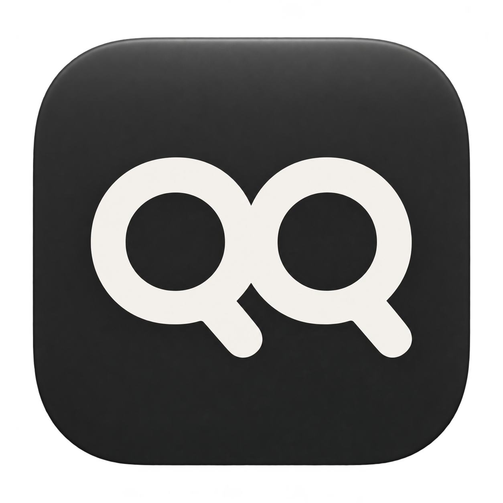

# qqdict

Hold a key. Say it. Keep writing.

qqdict is a small macOS menu bar app that turns your voice into text and pastes it into the field you’re using. It uses your existing Codex sign-in.

**[Download qqdict for Mac →](https://github.com/qwertyu-alex/qqdict/releases/tag/v0.5.0)**

[Apple Silicon](https://github.com/qwertyu-alex/qqdict/releases/download/v0.5.0/qqdict-0.5.0-mac-arm64.dmg) · [Intel](https://github.com/qwertyu-alex/qqdict/releases/download/v0.5.0/qqdict-0.5.0-mac-x64.dmg) · [All releases](https://github.com/qwertyu-alex/qqdict/releases)

Choose **Apple Silicon** (`arm64`) for an M-series Mac or **Intel** (`x64`) for an Intel Mac. Requires **macOS 13 or later**, a microphone, internet access, and a compatible Codex installation signed in with ChatGPT.

> Early preview: the current build is ad hoc signed and is not Apple notarized. Read [installation and first launch](docs/install.md) before opening it. The transcription connection uses an internal Codex protocol; it may change or stop working and is not a supported public subscription API. qqdict is an independent project, unaffiliated with OpenAI.

## Install

1. Download the `.dmg` for your Mac from [Releases](https://github.com/qwertyu-alex/qqdict/releases).
2. Open it and drag **qqdict** into **Applications**.
3. Open qqdict and complete the **Setup** tab: Codex sign-in, Microphone, Accessibility, and Input Monitoring.
4. Click a text field, hold **fn / Globe**, speak, and release to paste.

qqdict lives in the menu bar. Its window can be closed while dictation stays available. If macOS blocks the preview, follow Apple’s explicit **Open Anyway** flow in [the installation guide](docs/install.md).

## Small by design

- **Push to talk:** hold fn / Globe to record; release to transcribe. Right Option and Control + Option are available in Settings.
- **Paste where you write:** qqdict inserts into the originally focused field. If focus changes or the field is protected, your transcript stays available to copy.
- **Recent transcripts:** click the menu bar icon to recover and copy your last 10 dictations.
- **Floating island:** shows recording and transcription status, with one-click copy of the latest transcript. Drag it to any corner or the center of any screen edge; it remembers the position.
- **Markdown journal:** every completed transcript is appended with a timestamp to `~/Dictation/YYYY-MM.md`.
- **Your preferences:** choose a microphone and optionally open qqdict at login.

Recording stops on release and is limited to five minutes per take. The menu bar icon shows idle, recording, and transcribing states.

## What is sent and saved

Audio is streamed to the ChatGPT dictation service through your existing Codex authentication. This is **cloud transcription**, so it requires internet access. qqdict does not save audio files or store your Codex credential in its settings or transcript journal.

Transcripts are saved as plain text in `~/Dictation/` and in the app’s local recent-history cache. Treat the journal like any other document containing what you dictated. The app does not add analytics or a separate account service.

Accessibility enables paste into the focused app; Input Monitoring detects the selected modifier shortcut. The native helper observes modifier changes and focus metadata, rather than typed text or field contents. During automatic paste it temporarily preserves the clipboard and restores it unless you copy something else in the meantime. A manual **Copy** intentionally replaces the clipboard.

## Build from source

Use a Mac with **Node.js 22.12 or later** and the **Xcode Command Line Tools** installed. The lockfile pins dependencies.

```sh
git clone https://github.com/qwertyu-alex/qqdict.git
cd qqdict
npm ci
npm test
npm run start
```

`npm run start` builds the Swift helper and TypeScript app, then launches Electron. For reliable macOS permission registration, use a packaged app:

```sh
npm run package:mac
open release/qqdict.app
```

Create a drag-to-Applications installer and a ZIP:

```sh
npm run dist:mac
```

Each build targets the architecture of the installed Electron runtime. Separate Apple Silicon and Intel builds are produced by the release workflow; this is not a universal binary. See [release and signing instructions](docs/releasing.md) and the [native bridge notes](native/README.md).

## Help and development

[Troubleshooting](docs/troubleshooting.md) covers permissions, fn behavior, microphone selection, and missing paste results. Report problems through [GitHub Issues](https://github.com/qwertyu-alex/qqdict/issues), including your macOS version, Mac architecture, qqdict version, and what happened. Omit transcripts, account tokens, and other private data.

qqdict currently supports **macOS only**. The app is written in TypeScript with Electron; a small Swift helper handles the global shortcut and safe paste. Contributions are welcome.

## License

[MIT](LICENSE).
